# Awesome Architecture, Engineering & Construction (AEC) BIM Tools 🏗️📐

  

  
  
  
  
  
  

---

A curated, SEO-optimized directory of **Architecture, Engineering & Construction (AEC)** software, **Building Information Modeling (BIM)** platforms, cloud **Common Data Environments (CDEs)**, and **OpenBIM / IFC (Industry Foundation Classes)** toolchains. Whether you are an architect, structural or MEP engineer, BIM coordinator, VDC manager, or construction technologist, this guide covers industry-standard SaaS platforms and production-ready open-source developer libraries.

---

## 📑 Table of Contents
- [📊 Sector Overview & Market Dynamics](#-sector-overview--market-dynamics)
- [☁️ SaaS & Hosted Platforms](#️-saashosted-platforms)
- [💻 Open-Source GitHub Projects](#-open-source-github-projects)
- [🤝 How to Contribute](#-how-to-contribute)
- [💖 Support](#-support)
- [⭐ Star History](#-star-history)
- [📜 Disclaimer](#-disclaimer)

---

## 📊 Sector Overview & Market Dynamics

The global Building Information Modeling (BIM) and AEC software market is valued at approximately **$9.8 billion to $14.0 billion in 2026** and projected to grow at a **CAGR of 8.4% to 14.9%** through the mid-2030s, driven by government openBIM mandates, cloud CDE transitions, and AI-accelerated parametric design.

The market displays a **concentrated, oligopolistic core** at the enterprise tier—dominated by heavyweight incumbents like Autodesk, Trimble, Bentley Systems, and the Nemetschek Group—coexisting with a **highly fragmented startup and contech ecosystem** tackling specialized niches such as AI-driven MEP automation, field reality capture, carbon accounting, and decentralized OpenBIM data streaming.

---

## ☁️ SaaS/Hosted Platforms

The following table provides detailed pricing, verified free tiers / trial limits, and company scale (revenue / market valuation) for leading commercial AEC BIM platforms, sorted in descending order by company size.

| Platform | Description | Starting Pricing (Verified Tiers) | Free Tier / Trial Limits | Company Scale (Revenue / Valuation) |
| :--- | :--- | :--- | :--- | :--- |
| **[Autodesk Construction Cloud (BIM 360 / Docs / Build)](https://construction.autodesk.com)** | Comprehensive cloud Common Data Environment (CDE) uniting design authoring, model coordination, automated clash detection, and site execution. | **$67 to $117/user/month** (Autodesk Build Essentials billed annually; Docs available at ~$480/user/year) | **30-day free trial**; full feature access for up to 10 users per evaluation account (no permanent free tier). | **~$7.79B TTM Revenue** (~$54B Market Cap, NASDAQ: ADSK) |
| **[Navisworks & Autodesk Model Coordination](https://www.autodesk.com/products/navisworks)** | Industry-standard multi-disciplinary 3D model aggregation, 4D/5D construction scheduling simulation, and clash detection engine. | **$355/month** or **$2,835/year** per user (or 9 Flex tokens/day on-demand) | **30-day full-featured free trial** for Navisworks Manage; **Navisworks Freedom** is a permanent free viewer for NWD/DWF files. | **~$7.79B TTM Revenue** (~$54B Market Cap, NASDAQ: ADSK) |
| **[PlanGrid (Autodesk Build Field Management)](https://www.autodesk.com/products/plangrid)** | Mobile-first field productivity and construction drawing sheet management app syncing markups, punch lists, and BIM data to job sites. | **$39 to $69/user/month** (Nailgun/Dozer sheet tiers billed annually) | **21-day free trial** with access to sample projects and sheet annotation tools; no permanent free tier. | **~$7.79B TTM Revenue** (~$54B Market Cap, NASDAQ: ADSK) |
| **[Bentley SYNCHRO](https://www.bentley.com/software/synchro/)** | Advanced 4D construction digital twin, scheduling simulation, and field execution suite linking BIM geometry with CPM project schedules. | **~$4,980/year** per user for SYNCHRO 4D Pro; individual modular apps (Control/Field) priced separately | **30-day evaluation trial** on approved request (cloud projects auto-expire after 30 days); SYNCHRO Scheduler historically free. | **~$1.65B TTM Revenue** (~$13.6B Market Cap, NASDAQ: BSY) |
| **[Trimble Connect](https://connect.trimble.com)** | Open cloud BIM Common Data Environment (CDE) for sharing, federating, reviewing, and coordinating multi-format 3D models and point clouds. | **$12.99/user/month** (Trimble Connect Business tier billed annually; Business Premium at ~$23/user/month) | **Free Personal Plan**: 1 active online project, maximum 5 team members, and 10 GB cloud storage limit. | **~$3.85B TTM Revenue** (~$12.6B Market Cap, NASDAQ: TRMB) |
| **[Procore](https://www.procore.com)** | Unified enterprise construction management platform featuring 3D BIM coordination, project financials, submittals, and field communications. | **~$4,500 to $10,000/year minimum** (Scales based on Annual Construction Volume (ACV); includes unlimited users & storage) | **No permanent free tier**; custom sandbox demo/pilot available upon enterprise qualification with sales. | **~$1.45B TTM Revenue** (~$11.6B Market Cap, NYSE: PCOR) |
| **[Bluebeam Cloud & Revu](https://www.bluebeam.com)** | Real-time AEC PDF markup, quantity takeoff, and Studio collaboration platform tailored for design reviews, submittals, and shop drawings. | **$260/user/year** (Basics tier; Core at $330/user/year; Complete at $440/user/year; billed annually) | **14-day free trial** of Complete tier including Revu desktop, Studio, web, and mobile (no credit card required). | **Part of Nemetschek Group** (€1.19B / ~$1.45B Revenue; ~$10B Market Cap, FWB: NEM) |
| **[Solibri Office & Solibri Cloud](https://www.solibri.com)** | Automated rules-based BIM quality assurance (QA), IFC model integrity validation, code compliance checking, and BCF issue synchronization. | **~$99/year** (Starter tier for basic IFC viewing/checking; Essential & Advanced QA tiers start at ~$2,400+/year) | **30-day evaluation trial** of Solibri Office via sales or regional resellers; Solibri Anywhere viewer available with basic inspection limits. | **Part of Nemetschek Group** (€1.19B / ~$1.45B Revenue; ~$10B Market Cap, FWB: NEM) |
| **[Dalux](https://www.dalux.com)** | Mobile BIM viewer, Common Data Environment (CDE), quality control, and augmented reality (AR) field management suite. | **~$30 to $50/user/month** for paid modules (Field Pro / Dalux Box Pro custom project-based annual licensing) | **Free BIM Viewer & Field Basic**: Free forever for up to **3 active projects/buildings** with unlimited invited team members. | **~$100M+ ARR** (Privately held, Bootstrapped Danish AEC Tech Leader) |
| **[Revizto](https://revizto.com)** | Integrated Collaboration Platform (ICP) uniting 2D drawings and 3D BIM models into a real-time navigable game-engine environment with clash issue tracking. | **~$2,000 to $8,500+/month** per organization enterprise agreement based on active project volume (unlimited collaborator access) | **No self-serve free tier**; 30-day piloted evaluation provided following sales discovery and technical qualification. | **~$35M ARR** (Privately held, backed by Summit Partners) |

---

## 💻 Open-Source GitHub Projects

An actively maintained collection of open-source AEC, BIM, and spatial computing tools, **sorted in descending order by GitHub_Stars**. Each repository includes a live social Stars_Badge linking directly to its stargazers page.

- **[FreeCAD (BIM Workbench)](https://github.com/FreeCAD/FreeCAD)**   
  Cross-platform open-source parametric 3D CAD and BIM software supporting native IFC import/export, structural modeling, and 2D drawing generation.

- **[OpenProject (BIM Edition)](https://github.com/opf/openproject)**   
  Open-source project management and Common Data Environment (CDE) platform featuring integrated 3D IFC model viewing and BCF issue tracking.

- **[Potree](https://github.com/potree/potree)**   
  WebGL-based open-source point cloud renderer for massive LiDAR, drone photogrammetry, and scan-to-BIM datasets.

- **[CloudCompare](https://github.com/CloudCompare/CloudCompare)**   
  3D point cloud processing, mesh manipulation, and scan-vs-BIM as-built comparison software.

- **[IfcOpenShell & Bonsai](https://github.com/IfcOpenShell/IfcOpenShell)**   
  Foundational open-source C++ and Python library, geometry engine, and native IFC authoring environment (Bonsai / BlenderBIM) for parsing, authoring, and validating IFC BIM models.

- **[pyRevit](https://github.com/pyrevitlabs/pyRevit)**   
  Popular open-source Rapid Application Development (RAD) environment for Autodesk Revit enabling BIM managers to automate workflows using Python and .NET.

- **[BIMserver (Open-Source BIM Server)](https://github.com/opensourceBIM/BIMserver)**   
  Self-hosted open-source model server built on an IFC-driven core for storing, querying, merging, and versioning building information models.

- **[xeokit-sdk](https://github.com/xeokit/xeokit-sdk)**   
  High-performance open-source 3D WebGL graphics SDK engineered specifically for viewing massive, full-precision AEC BIM models (IFC, BCF, glTF, point clouds) in web browsers.

- **[Speckle (Open-Source AEC Data Hub)](https://github.com/specklesystems/speckle-server)**   
  Open-source collaborative 3D/BIM data platform and connector ecosystem enabling real-time geometry and metadata streaming between Revit, Rhino, Grasshopper, Blender, and AutoCAD.

- **[That Open Engine (formerly IFC.js)](https://github.com/ThatOpen/engine_components)**   
  High-performance open-source TypeScript and Three.js toolkit for building browser-native 3D BIM viewers, IFC parsers, and cloud AEC web applications.

- **[Autodesk Revit IFC](https://github.com/Autodesk/revit-ifc)**   
  Open-source .NET/C# codebase for Autodesk Revit's official IFC export and import functions across multiple schema versions.

- **[xBIM Toolkit](https://github.com/xBimTeam/XbimEssentials)**   
  Open-source .NET/C# software toolkit for working with building data in the IFC format, geometric processing, and web visualization.

- **[Hypar Elements](https://github.com/hypar-io/Elements)**   
  Open-source cross-platform C# library and data model for generative building design, automated layout calculations, and BIM workflows.

- **[COMPAS Framework](https://github.com/compas-dev/compas)**   
  Open-source computational framework for collaboration, structural modeling, and research in architecture, engineering, and digital fabrication in Python.

- **[IfcTester / IDS](https://github.com/buildingSMART/IDS)**   
  Official openBIM Information Delivery Specification (IDS) model checking, validation, and automated compliance auditing toolset.

- **[BCF-XML / OpenBCF Tools](https://github.com/buildingSMART/BCF-XML)**   
  Official open-standard XML schemas, documentation, and reference tools for BIM Collaboration Format (BCF) issue tracking.

- **[Ladybug Tools](https://github.com/ladybug-tools/ladybug)**   
  Open-source environmental and building performance simulation suite connecting CAD/BIM tools to validated simulation engines (EnergyPlus, Radiance).

- **[BIMvie.ws](https://github.com/opensourceBIM/bimvie.ws)**   
  Open-source web-based BIM user interface and plugin framework designed to interact with BIMserver repositories directly from a browser.

- **[sam-aec/aec-model-bridge](https://github.com/Sam-AEC/aec-model-bridge)**   
  Interoperability and model bridge utility connecting BIM workflows across architectural and engineering environments.

---

## 🤝 How to Contribute

Contributions are warmly welcomed! Help make this ecosystem guide even better:

1. 🍴 **Fork** the repository.
2. 🌿 **Create a branch** for your feature or tool addition (`git checkout -b feature/add-new-bim-tool`).
3. ✏️ **Edit `README.md`**: Follow the established format (name, official link, specific pricing & free limits for SaaS; official repo link and Shields badge for Open-Source).
4. 🚀 **Commit & Push** your changes (`git commit -m "Add New BIM Tool"`).
5. 📬 **Open a Pull Request** with a concise description of the software added.

---

## 💖 Support

If this curated AEC BIM repository helps your architectural practice, engineering workflow, or openBIM software development, please consider showing your support:

- ⭐ **Star** this repository on GitHub!
- 🍴 **Fork** and share it with fellow architects, engineers, and BIM specialists.
- ☕ **Sponsor / Buy a coffee**: Support ongoing curation and maintenance via the [GitHub Sponsor Dashboard](https://github.com/sponsors/ishandutta2007).

---

## ⭐ Star History

---

## 📜 Disclaimer

- This is a **community-curated** directory — not exhaustive and not an endorsement of specific commercial vendors.
- BIM geometry, structural loads, clash reports, and construction specifications generated or coordinated via open-source or SaaS tools must always be validated by licensed AEC professionals prior to fabrication and on-site construction.
- Self-hosted Common Data Environments (CDEs) and BIM servers require proper role-based access control (RBAC), end-to-end encryption (TLS/HTTPS), and regular snapshot backup strategies.

---

**Made with ❤️ for architects, BIM managers, structural & MEP engineers, general contractors, and AEC developers.**
